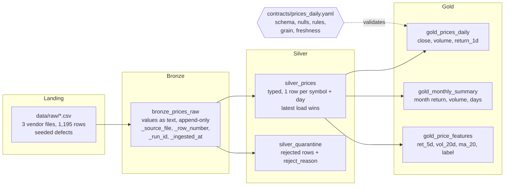

# market-data-lakehouse

[](https://github.com/harshpatel98/market-data-lakehouse/actions/workflows/ci.yml)

A medallion-architecture batch pipeline for daily market prices, written in Python with pandas and
SQLite. Bronze lands three dirty vendor files untouched, append-only, with lineage columns. Silver
standardises and types the data, quarantines invalid rows with a reject reason, and de-duplicates so
the latest load wins. Gold publishes two BI tables and a point-in-time ML feature table. A YAML data
contract is enforced in code, and 29 pytest tests run in GitHub Actions on every push and pull request.
All data is synthetic and generated with nine seeded defect types.

## Architecture



## Quickstart

From a fresh clone, inside a virtual environment (`python -m venv .venv`, then activate it):

```bash
pip install -r requirements.txt
pytest
python -m src.pipeline
```

The pipeline writes all tables to `output/lakehouse.db` (SQLite) and prints a summary:

```
bronze       1195 rows appended to bronze_prices_raw (run run-...)
silver       1156 rows in silver_prices
quarantine     14 rows in silver_quarantine {'high_below_low': 5, 'non_positive_close': 5, 'null_date': 4}
gold         1156 rows in gold_prices_daily
gold           54 rows in gold_monthly_summary
gold         1081 rows in gold_price_features
contract   gold.prices_daily: pass
freshness  newest trade_date 2025-06-30: stale (...)
```

Options: `--raw-dir`, `--db`, `--contract`, `--run-id`. The freshness check compares the newest trade
date with today's date; the bundled synthetic data ends in June 2025, so it reports stale by design.
The run exits non-zero if the gold table breaks its contract.

## Layers

| Layer | Code | What it does |
| --- | --- | --- |
| Bronze | `src/bronze.py` | Reads every CSV in sorted file order with `dtype=str`, so no value is cast or cleaned. Adds `_source_file`, `_row_number` (0-based within the file), `_run_id` and `_ingested_at` (UTC). Appends to SQLite; loading twice doubles the table. |
| Silver | `src/silver.py` | Standardises symbols, parses ISO and US dates, parses prices with `$` and thousands separators, then splits valid and invalid rows. Invalid rows go to quarantine with the first matching reason. Valid rows are de-duplicated on `(symbol, trade_date)`, and the latest load wins. |
| Gold | `src/gold.py` | `daily_prices` (1-day return per symbol), `monthly_summary` (first and last close, month return, total volume, trading days), `price_features` (point-in-time ML features plus a forward label). |
| Contract | `src/contract.py`, `contracts/prices_daily.yaml` | Validates a gold table against the YAML contract and checks freshness. |
| Runner | `src/pipeline.py` | Runs bronze, silver and gold in order, writes the tables and checks the contract. |

## Data contract

`contracts/prices_daily.yaml` describes `gold.prices_daily`. `src/contract.py` enforces:

- **Columns and kinds**: each listed column must exist and have the declared kind (`string`, `date`,
  `number`).
- **Nullability**: `symbol`, `trade_date` and `close` must not be null; `volume` may be.
- **Value rules**: `close` must be greater than 0 (`min_exclusive: 0`).
- **Grain**: `(symbol, trade_date)` must be unique.
- **Freshness**: the newest `trade_date` must be at most `max_age_days` (3) days old.

`validate()` returns a list of violation messages, and an empty list means the data passes. The
contract's `owner`, `change_policy` and `consumers` fields are documentation for people and are not
checked in code.

## Seeded defects and how the pipeline handles them

`scripts/generate_data.py` builds a clean synthetic price history (QQQ, SPY, BTC; weekdays from
2024-01-01 to 2025-06-30, seed 42), splits it into three landing files, and plants nine defect types:

| # | Defect | Rows | How the pipeline handles it | Verified by |
| --- | --- | --- | --- | --- |
| 1 | Messy symbols (`spy`, ` SPY `, `Spy`) | 7 | Silver strips and upper-cases symbols | `test_standardize_symbol`, `test_build_silver_on_real_landing_files` |
| 2 | US-style dates (`MM/DD/YYYY`) | 8 | Silver parses both ISO and US formats; unparseable dates become null | `test_parse_date_handles_both_formats_and_bad_values` |
| 3 | Prices as strings with `$` and thousands separators | 6 | Silver removes `$` and `,` before converting; invalid text becomes null | `test_parse_price_handles_symbols_and_blanks` |
| 4 | Exact duplicate rows | 15 | Silver keeps one row per `(symbol, trade_date)` | `test_dedupe_latest_keeps_last_load`, integration test |
| 5 | Late corrections: a later file restates an earlier day with a new close | 10 | Latest load wins, ordered by source file then row number | `test_late_corrections_win` |
| 6 | Missing trade date | 4 | Quarantined as `null_date` | `test_split_valid_reasons_and_precedence`, integration test |
| 7 | Close of zero or below | 5 | Quarantined as `non_positive_close` | same |
| 8 | High below low (swapped) | 5 | Quarantined as `high_below_low` | same |
| 9 | Missing days: three consecutive BTC weekdays are absent | 3 | **Not detected.** There is no row to quarantine, so silver simply has no rows for those days. The expected silver count accounts for the gap. Gap detection is listed under Next steps. | expected silver count |

Bronze keeps all of these exactly as received (`test_raw_values_are_not_cleaned`). The integration
test checks the totals: 1,195 raw rows, 1,156 silver rows and 14 quarantined rows. Silver also has a
`null_close` rule for a missing close, which none of the seeded defects triggers.

## Design decisions

- **Bronze is immutable and replayable.** Values stay as text and nothing is fixed on the way in, so
  any silver rule can be changed and rebuilt from bronze. The lineage columns trace every silver or
  quarantine row back to its file, line and run.
- **Idempotent reruns.** Bronze is append-only by design: each run adds its rows under its own
  `_run_id`, so history is kept and duplicate loads stay visible. Silver and gold are rebuilt from the
  run's bronze load and replace the previous tables, so rerunning with the same input produces the same
  silver and gold tables. (Two runs give 2,390 bronze rows and the same 1,156 silver rows.)
- **Quarantine, not silent drops.** Rows that fail validation are kept in `silver_quarantine` with a
  `reject_reason`, and the first failing rule in a fixed order wins. Bad data stays visible and
  countable, and it can be reported back to the source.
- **Order of operations.** Standardise and type, then validate, then de-duplicate the valid rows. If
  dedupe ran before validation, an invalid restatement could replace a valid earlier row.
- **Latest load wins, deterministically.** Duplicates are resolved by `(_source_file, _row_number)`, so
  the result depends on load order rather than on arrival timing or sort stability, and late corrections
  replace the original values.
- **Point-in-time features.** Every feature for an `as_of_date` uses only that day and earlier rows:
  `ret_5d` uses the close five rows back, `vol_20d` is the standard deviation of the trailing 20 daily
  returns, and `ma_20` is the trailing 20-day mean. Only the `label` looks forward (the close
  `horizon` rows later), and it is kept separate. `test_features_have_no_lookahead` removes all data
  after 2024-12-31, rebuilds the features, and asserts that every overlapping feature value is
  unchanged. Look-ahead leakage would make a model look better in backtests than it can be in
  production.

## Project layout

```
contracts/prices_daily.yaml   data contract for gold.prices_daily
data/raw/                     three synthetic landing files with seeded defects
data/prices_clean.csv         clean synthetic base data (used by the gold tests)
data/expected_counts.json     expected row counts and late corrections (used by the tests)
scripts/generate_data.py      regenerates all of data/ deterministically (seed 42)
src/bronze.py, silver.py, gold.py, contract.py, pipeline.py
tests/                        29 pytest tests: unit, integration and no-look-ahead
.github/workflows/ci.yml      tests and an end-to-end pipeline run on push and pull request
```

## Next steps (future work, not implemented)

- **Delta Lake and Databricks version**: re-implement bronze, silver and gold in PySpark on Delta
  tables, using MERGE for latest-load-wins upserts and time travel for audits.
- **Orchestration**: schedule the layers as a DAG with retries and alerting, and add backfills by
  logical date.
- **Data catalog and lineage**: register the tables with owners, descriptions and classification,
  and capture lineage automatically.
- **Completeness checks**: detect missing trading days (defect 9) by comparing each symbol's dates
  against a trading calendar.
- **Run log**: a `pipeline_runs` table with rows in, out and rejected, status and duration per step.

## Data

All data in this repository is synthetic. It was generated by `scripts/generate_data.py` and is not
real market data.

## License

MIT. See [LICENSE](LICENSE).
